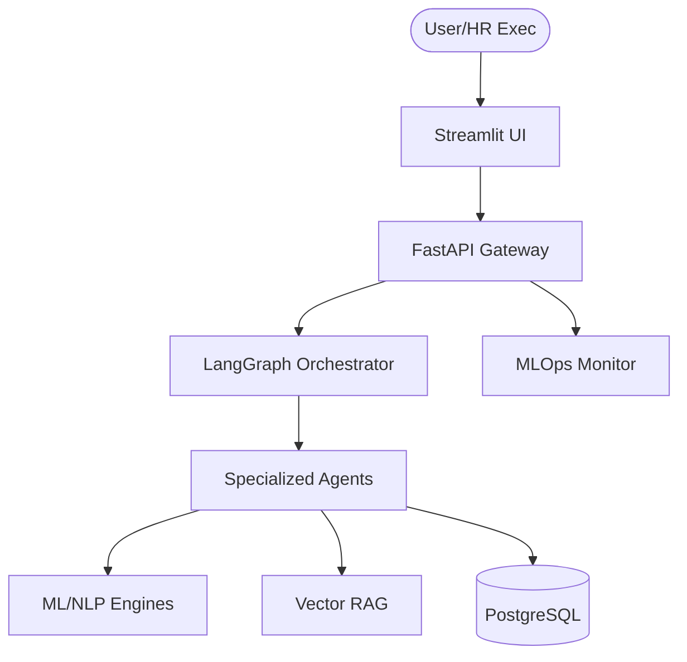

# Agentic HRMS: Enterprise Workforce Intelligence Platform

## Overview
This platform is a comprehensive business decision-support system transitioning from predictive machine learning to a full Agentic HRMS architecture.

It is designed to solve core business problems:
1. **Attrition Prediction & Retention:** Anticipating flight risks and simulating salary/WLB interventions to save turnover costs.
2. **Skill Gap Engine:** Comparing employee and candidate capabilities against organizational demands to guide Internal Mobility vs External Hiring.
3. **Knowledge Retrieval:** Using Vector-based RAG to immediately parse and retrieve HR handbooks and compliance policies.
4. **Agentic Workflows:** Orchestrating LangGraph agents with Role-Based Access Control (RBAC) governance to execute backend tasks (e.g., Leave Approvals).

## Architecture Diagram


## Setup Instructions

### Docker (Production Recommended)
The entire platform runs via a hardened Docker Compose stack:
```bash
docker compose up --build -d
```
- API & Agents will be available at `http://localhost:8000`
- Dashboard UI will be available at `http://localhost:8501`

*(Note: The database seeds automatically on the first backend boot).*

## Key Features & Enterprise Upgrades
- **Agent Governance:** Strict Role-Based Access Control. `managers` cannot auto-approve leave or payroll changes, while `admin` users can utilize agent tools seamlessly.
- **Data Drift Detection:** Live tracking of `data/predictions/predictions.log` against the raw training baseline inside `app/ml/monitor.py`.
- **Open-Source RAG:** Fully local semantic search using `sentence-transformers` for instant HR policy retrieval without exposing internal company data to cloud LLM providers.
- **Executive ROI Dashboard:** Visualizes the direct financial impact of the platform (Attrition Savings, Time-to-Hire Reduction, Reskilling Success).

## Monitoring Strategy
- Data distribution drift is monitored via `check_data_drift()`.
- Model performance is tracked against baseline metrics (F1/ROC-AUC).
- Prediction probabilities and risk levels are logged to `data/predictions/predictions.log`.

**Retraining Rule**: 
Retrain if drift > threshold, F1 drops below 0.75, or 6 months of new data is collected.